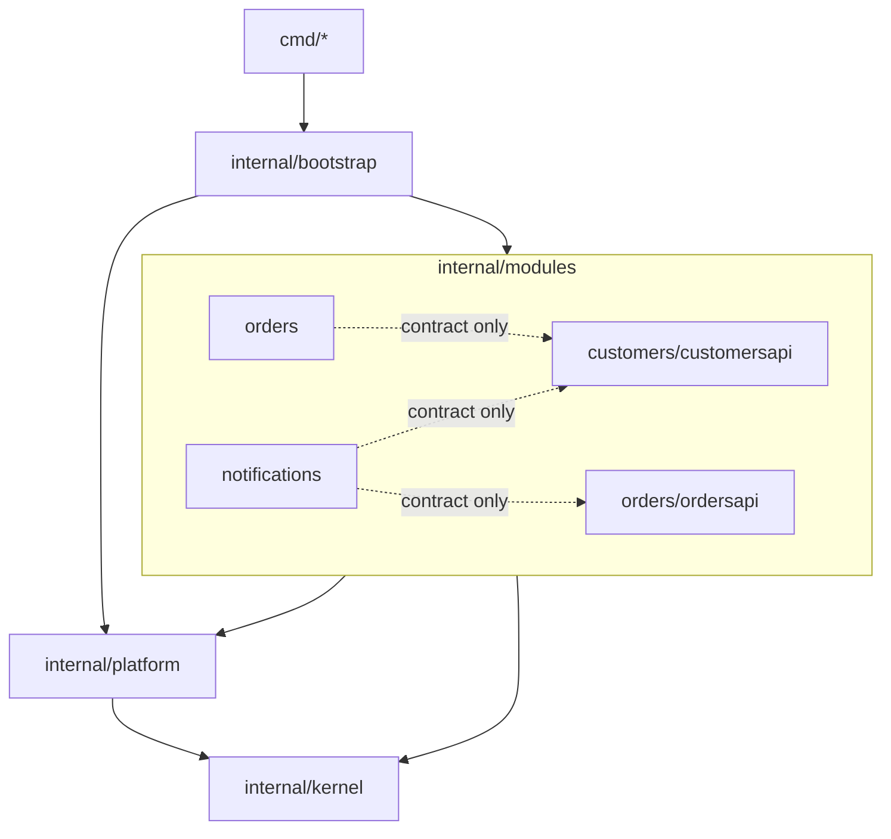

# Architecture

This repository is a template for a **modular monolith** in Go: one Go
module, one container image, one database server, and inside it a set of
business modules that are as isolated from each other as separate services
would be.

You get the operational simplicity of a monolith (one build, one deploy,
local function calls, real transactions) and keep the option of extracting a
module into its own service later, because the seams are already there.

The rules below are not aspirations. Each is enforced by the compiler, the
database, `internal/archtest` or the linter; [section 13](#13-how-the-rules-are-enforced)
says which. The reasons behind the big decisions are recorded in
[docs/adr](docs/adr/README.md), and the modules that currently exist are
listed in the generated [docs/MODULES.md](docs/MODULES.md).

## Contents

1. [The shape of the system](#1-the-shape-of-the-system)
2. [Dependency rules](#2-dependency-rules)
3. [Anatomy of a module](#3-anatomy-of-a-module)
4. [How modules talk to each other](#4-how-modules-talk-to-each-other)
5. [Data ownership and transactions](#5-data-ownership-and-transactions)
6. [Shared code: kernel and platform](#6-shared-code-kernel-and-platform)
7. [Processes and environments](#7-processes-and-environments)
8. [Observability](#8-observability)
9. [Cross-cutting conventions](#9-cross-cutting-conventions)
10. [Testing strategy](#10-testing-strategy)
11. [Recipes](#11-recipes)
12. [What is deliberately left out](#12-what-is-deliberately-left-out)
13. [How the rules are enforced](#13-how-the-rules-are-enforced)
14. [Extracting a module into a service](#14-extracting-a-module-into-a-service)

## 1. The shape of the system

```text
cmd/                        one tiny main per process
  server/                     everything in one process
  api/                        HTTP API only
  worker/                     event delivery only
  migrate/                    apply migrations, then exit
internal/
  bootstrap/                composition root: builds everything, wires modules together
  kernel/                   shared *domain* vocabulary; pure, no I/O
    apperr/                   classified errors (invalid, not found, conflict, ...)
    clock/                    time as a dependency
    event/                    what an integration event is
    id/                       UUIDv7 identifiers
    money/                    amounts in minor units
  platform/                 shared *technical* capabilities; knows no business
    buildinfo/                service name and version of this build
    config/                   environment -> typed, validated configuration
    eventbus/                 in-process event routing
    httpx/                    JSON, problem responses, middleware, server lifecycle
    logging/                  slog setup, trace-aware and request-scoped loggers
    module/                   the interface every module implements
    outbox/                   transactional outbox: publisher + relay
    postgres/                 pools, per-module roles, transactions, migrations
    telemetry/                OpenTelemetry tracing and metrics
  modules/                  the business, one directory per domain
  archtest/                 the rules in this document, as tests
tools/                      developer tooling: module generator, module map
deploy/                     per-environment settings and deployment notes
docs/                       decision records (adr/) and the generated module map
```

Three kinds of code, with three different jobs:

| Layer | Answers the question | May depend on |
| --- | --- | --- |
| **modules** | What does the business do? | kernel, platform, the *contracts* of modules it declares |
| **platform** | How do we talk to the outside world? | kernel |
| **kernel** | What words do all modules share? | nothing |

`bootstrap` and `cmd` sit above all three and are the only code allowed to
see everything.

The template ships with three example modules (`customers`, `orders`,
`notifications`) that exercise every pattern described here. Remove them with
`make remove-examples` when you start a real service; the structure stays.

## 2. Dependency rules



1. **Dependencies point downwards.** `kernel` imports nothing from this
   repository. `platform` imports only `kernel`. Neither ever imports a
   module.
2. **A module's only public surface is its contract package**
   (`modules/<name>/<name>api`). Other modules may import that and nothing
   else from the module.
3. **Dependencies between modules are declared.** A module lists the modules
   it uses in its `module.json`. Importing an undeclared contract fails the
   build, a declared but unused one too, and the declared graph must have no
   cycles.
4. **Contracts are leaves.** A contract imports only the kernel and the
   standard library, so importing one drags in no implementation.
5. **Inside a module, dependencies point inwards:**
   `adapters -> app -> domain`. Domain and application code import no
   third-party packages and no platform packages; they reach the outside
   world through interfaces they declare themselves.
6. **Only the composition root sees concrete modules.**
   `internal/bootstrap/modules.go` is the single place that constructs
   modules and decides who gets which dependency.
7. **No junk drawers.** There is no `common`, `utils`, `helpers` or `shared`
   package. Shared code is named after the one thing it provides.

Go's `internal/` directories give rule 2 teeth for free: everything under
`modules/orders/internal/` is unimportable from outside `modules/orders/`.

## 3. Anatomy of a module

```text
modules/orders/
  module.json               what the module is for and which modules it uses
  module.go                 wiring: Deps in, module.Module out. Imported only by bootstrap.
  ordersapi/                PUBLIC contract: DTOs, interfaces, integration events
  migrations/               SQL owned by this module (schema "orders")
  internal/                 PRIVATE; the compiler keeps other modules out
    domain/                   entities, value objects, invariants. Pure.
    app/                      use cases + the ports (interfaces) they need
    adapters/
      httpapi/                inbound: HTTP -> use case
      pgstore/                outbound: repository port -> PostgreSQL
      customersacl/           outbound: port -> another module's contract
```

**`domain`** holds the rules that would still be true if there were no
database and no HTTP: what a valid order is, how a total is computed. It is
plain Go, trivially unit-tested, and has no idea how it is stored or served.

**`app`** holds the use cases (`PlaceOrder`, `GetOrder`). A use case loads
and saves through *ports*: small interfaces declared right there, next to the
code that calls them, describing what the use case needs in its own words
(`Repository`, `CustomerDirectory`, `EventPublisher`, `Transactor`). The app
layer decides transaction boundaries; it never knows what implements a port.

**`adapters`** connect ports to technology. Inbound adapters (HTTP handlers,
event subscribers) translate a transport message into a use-case call.
Outbound adapters (repositories, clients) implement ports. All SQL, JSON
tags, status codes and third-party imports live here.

**`<name>api`** is the contract other modules compile against. It contains
data and interfaces, never behaviour. Its types are separate from the domain
model on purpose: the domain must be free to change without breaking
consumers, and consumers must never see more than they were promised.

**`module.go`** assembles the above from a `Deps` struct and implements
`platform/module.Module` (name, migrations, routes, subscribers).

**`module.json`** is the module's entry in the system's map: a one-sentence
description and the list of modules it depends on. Its owner is the matching
line in `.github/CODEOWNERS`.

### Layers scale with the module, not the other way round

The layout above is for a module with real business rules. Do not apply it
mechanically. `notifications` has no `domain` package because it has no
invariants worth isolating, and a freshly generated module starts with `app`
and adapters only. Start with the least structure that keeps the dependency
direction right, and split a package when it has grown a boundary worth
naming. What is not negotiable is the outside of the module: a manifest, a
contract package, private internals, its own schema.

## 4. How modules talk to each other

Modules never share tables, never call each other's internals, and never
reach each other through HTTP on localhost. There are exactly two ways.

### 4.1 Synchronous: a query through a contract

Use this when a module needs an answer *now* to do its own job. `orders`
must know that a customer exists before accepting an order:

```text
orders/module.json             declares the need     "uses": ["customers"]
orders/internal/app            declares the port     CustomerDirectory.Exists(ctx, id)
orders/internal/adapters/
       customersacl            implements it using   customersapi.API.GetCustomer
customers/customersapi         declares the contract API
customers/module.go            implements it         on top of its own app.Service
bootstrap/modules.go           connects them         Customers: customersModule.API()
```

Three things to notice:

- **The consumer owns the interface.** `orders` asks only "does this
  customer exist?", the one question it has, not for the whole customers
  API. The port documents exactly what `orders` depends on and is trivial to
  fake in tests.
- **The adapter is an anti-corruption layer.** `customersacl` is the only
  file in `orders` that knows the customers contract exists. If that
  contract changes, one small file changes.
- **It is an in-process function call**, wired by hand in `bootstrap`. No
  service locator, no registry, no reflection.

Keep these calls to *queries*. If module A needs module B to *change state*
as part of A's use case, that is a workflow, and it belongs in an event
(below) or in a module that sits above both.

### 4.2 Asynchronous: integration events through the outbox

Use this when a module announces something that happened and does not care
who reacts. `orders` publishes `OrderPlaced`; `notifications` reacts:

```text
orders/ordersapi               defines the event     OrderPlaced ("orders.order_placed.v1")
orders/internal/app            publishes it          inside the transaction that saves the order
platform/outbox                stores it             INSERT into outbox.messages, same transaction
platform/outbox (relay)        delivers it           after commit, to every subscriber
notifications/.../subscribers  receives it           translates it into a use-case call
```

**Why an outbox?** Saving the order and announcing it must be atomic.
Publish before the commit and you may announce an order that never existed;
publish after and a crash loses the event. The outbox writes the event
*with* the order, in one transaction, and a relay delivers it afterwards.
`outbox.Publisher` refuses to run outside a transaction, so this cannot be
forgotten.

**What subscribers must assume:**

- Delivery is **at least once**. A handler may see the same event twice, so
  it must be idempotent. `notifications` stores each notification with a
  unique `event_id` and treats a duplicate as already done.
- Delivery is **asynchronous**. The publisher's request returns before any
  subscriber ran. Subscribers are eventually consistent with the publisher.
- **Ordering is not guaranteed** once retries are involved. Put what the
  handler needs in the event rather than relying on sequence.
- A handler that keeps failing is retried with backoff up to
  `OUTBOX_MAX_ATTEMPTS`, then left in `outbox.messages` with its last error
  for a human to look at. Monitor that table and the `outbox.deliveries`
  metric.

**Events are a published API.** The name carries a version
(`orders.order_placed.v1`). Add optional fields freely; for a breaking
change publish `v2` alongside `v1` until every subscriber has moved.

### 4.3 Choosing

| Situation | Use |
| --- | --- |
| I need data owned by another module to validate or answer a request | Synchronous query |
| Something happened that others may care about | Event |
| Another module must do work as a consequence of mine | Event |
| Two modules need each other | Events in one direction, or a third module that orchestrates both |
| I want a foreign key or a join across modules | Neither; see the next section |

The architecture tests reject cycles between modules. When two modules need
each other, do not hide the cycle behind callbacks or a registry: decide
which one owns the operation, turn the other direction into an event, or
introduce a higher-level module whose job is the workflow.

## 5. Data ownership and transactions

**One module, one schema, one role.** `orders` owns the PostgreSQL schema
`orders`. Its migrations create the role `orders_rw`, which can use that
schema and nothing else, and at runtime the module gets its own connection
pool whose sessions run as that role. SQL that reaches into another module's
tables fails with "permission denied", in tests and in production.

**No cross-module foreign keys or joins.** `orders.orders.customer_id` is a
plain `uuid`, not a reference. A foreign key is a compile-time dependency
the compiler cannot see, and it is what makes a module impossible to
extract. Need data from two modules together? Ask each one through its
contract, or build a read model fed by events.

**Each module migrates itself.** Migrations live in the module, are embedded
in the binary, and have their own history table
(`<schema>.goose_db_version`). `cmd/migrate` applies them under an advisory
lock, so concurrent runs are safe. Migrations are forward-only in
production: ship additive changes, and remove columns one release after the
code stopped using them.

**The application layer owns transactions.** A use case wraps its writes in
`tx.WithinTx(ctx, func(ctx) error { ... })`. The transaction travels in the
context; repositories call `db.Conn(ctx)` and get the transaction if there
is one, the pool if not. Repositories therefore never begin or commit
anything on their own account, and the same repository method works inside
and outside a transaction.

**A transaction never spans modules.** A use case writes its own module's
tables plus the outbox, and that is all. Consistency *between* modules is
eventual and travels by event. This is exactly the constraint you would
have with separate services, accepted early so that it never becomes a
surprise.

Practicalities: PostgreSQL 16 or newer is required. The user that runs
migrations must be allowed to create roles; if the service connects as a
different user, grant that user each `<module>_rw` role. Every pool can grow
to `DATABASE_MAX_CONNS`, so the total is that number times the modules plus
two.

A note on context: the transaction and the request-scoped logger ride in
`context.Context` because they are request-scoped *state*. Dependencies
(repositories, clients, other modules) never do; they are constructor
arguments.

## 6. Shared code: kernel and platform

Functionality used by more than one module is lifted up, but into one of two
places with very different rules.

**`internal/kernel`** is the shared domain vocabulary: types that mean the
same thing in every module. It is pure (no I/O, no logging, no third-party
imports beyond a short allow-list), tiny, and changes rarely, because a
change here is a change to every module at once.

**`internal/platform`** is technical capability: configuration, HTTP,
database, messaging, telemetry. It may use third-party libraries freely, and
it knows nothing about customers or orders. Swapping the event transport or
the tracing backend should touch `platform` and adapters only.

### When to lift code up

Lifting is a one-way door, so ask first:

1. **Do the consumers agree on the meaning, or only on the syntax?** Two
   modules both having a `Customer` struct is not duplication; they mean
   different things by it. `money.Money` is shared because every module
   agrees what an amount is. A module that needs signed refunds or sub-cent
   prices should define its own type instead of loosening the shared one.
2. **Is it the third use?** Two similar pieces of code in two modules are
   cheaper than one wrong abstraction coupling both. Duplicate once; lift on
   the third occurrence, when the common shape is actually known.
3. **Does it have a name?** If the best name is `utils`, it is not one thing
   yet. `archtest` rejects junk-drawer names.
4. **Who owns it?** Shared code needs tests and an owner like any module.

What never gets lifted: business rules ("an order needs at least one line"),
persistence models, and anything that would make `kernel` or `platform`
import a module.

When several *services* built from this template need the same library,
that is the moment for a separately versioned Go module, not before.

## 7. Processes and environments

**One image, four binaries.** Every binary contains every module; a role
only decides which inbound adapters are switched on.

| Binary | Runs | Use it |
| --- | --- | --- |
| `server` | migrations, HTTP API and event worker | locally, and in production while one process is enough |
| `api` | HTTP API | when request handling must scale on its own |
| `worker` | outbox relay and event subscribers | when event delivery must scale on its own |
| `migrate` | migrations, then exits | as a release step, before `api` and `worker` |

A process cannot host a subset of modules. The outbox is a single queue, so
a worker missing some subscribers would mark their events delivered. Running
modules in separate processes means extracting them
([section 14](#14-extracting-a-module-into-a-service)).

**Environments differ only in configuration.** The same image runs in
`local`, `dev`, `staging` and `production` (`APP_ENV`).

- Configuration is environment variables, read once at startup by
  `platform/config`, validated all at once, and passed down as values.
  Modules never read the environment. `.env.example` documents every
  setting.
- Non-secret settings per environment are committed in `deploy/env/` and
  validated by a test, so a typo fails in CI instead of at release.
- Secrets never enter the repository; the deployment platform injects them.
- `APP_ENV` labels logs and telemetry and picks a few defaults (text logs
  locally, JSON elsewhere). It must never switch business behaviour: use an
  explicit setting for that, so every environment can exercise both sides.

**Delivery.** Pull requests run the checks. A push to `main` runs them
again, publishes the image and deploys to `dev`; a version tag deploys the
same image to `staging` and then `production`. The image is built once and
promoted by digest. [deploy/README.md](deploy/README.md) has the details.

**Lifecycle.** SIGINT/SIGTERM cancel the root context.
`bootstrap.App.Run` supervises the HTTP server and the relay; when either
stops, both shut down. The listener is bound before serving so a port
conflict fails startup, in-flight requests get `HTTP_SHUTDOWN_TIMEOUT` to
finish, and telemetry is flushed last. Whoever constructs a resource closes
it: `bootstrap` opens the pools and closes them, modules only borrow.

**Health.** `/healthz` is liveness and checks nothing, so a database outage
does not get the process restarted. `/readyz` checks dependencies and takes
the instance out of rotation while they are down. Every process serves both.

## 8. Observability

Instrumentation lives at the edges, in `platform`. Business code is not
instrumented and never imports a telemetry library; it only has to pass its
`context.Context` along and log with the `*Context` methods.

**Logging.** `log/slog`, structured, JSON outside local development. Every
line carries the service, process, environment and version, plus the
request ID and the trace and span IDs when there are any. Access logs record
the matched route pattern, never raw paths or query strings.

**Tracing.** OpenTelemetry. One trace follows a request across the whole
system:

- `httpx` starts a span per request, continuing the caller's trace when a
  `traceparent` header is present;
- `postgres` adds a span per SQL statement within a trace;
- `outbox` stores the trace context with each event and restores it on
  delivery, so the handlers that run later, possibly in another process,
  appear in the trace of the request that caused them.

**Metrics.** `http.server.request.duration` by route and status, and
`outbox.deliveries` by event and outcome. Add instruments in `platform` or
in adapters with `otel.Meter`.

**Export** is OTLP over HTTP, off until `OTEL_EXPORTER_OTLP_ENDPOINT` is
set, and configured entirely with the standard `OTEL_*` variables, so any
compatible backend works. `make up-observability` starts one locally.

## 9. Cross-cutting conventions

**Errors.** Business code returns `*apperr.Error` values that carry a `Kind`
(invalid, not found, conflict, ...), a stable namespaced `Code`
(`orders.unknown_customer`) and a client-safe message. Each module declares
its errors as package-level values. `httpx.Error` maps kinds to status codes
and renders RFC 9457 problem documents. Anything unclassified is logged in
full and returned as an opaque 500, so internals never leak; a deadline
becomes 504 and a client cancellation 408. Wrap with `%w` and test with
`errors.Is`.

**Validation happens twice, on purpose.** The transport adapter rejects
malformed input (bad JSON, unknown fields, oversized bodies). The domain
enforces business invariants, because HTTP is not the only caller.

**HTTP.** Standard library `net/http` with method-and-path patterns. Each
module registers its routes under `/api/v1/<module>`. Request and response
structs live in the adapter and are distinct from domain types, so renaming
a domain field can never silently change the public API.

**Dependency injection** is constructors and structs.
`bootstrap/modules.go` is the dependency graph, written as ordinary code
that the compiler checks.

**IDs and time.** IDs are UUIDv7, generated in the application so an entity
is complete before it is stored. Time comes from an injected `clock.Clock`,
never `time.Now()` in business code.

**Ownership and decisions.** Every module has an owner in
`.github/CODEOWNERS`. Decisions that are costly to reverse get a record in
`docs/adr/`. `docs/MODULES.md` is generated from the code (`make docs`) and
a test fails when it is stale.

## 10. Testing strategy

| Level | What it proves | How | Speed |
| --- | --- | --- | --- |
| Domain | Business rules | Plain table-driven unit tests | Instant |
| Application | Use-case orchestration: what is stored, published, rejected | Hand-written fakes of the ports | Instant |
| Platform | Infrastructure behaves: outbox atomicity, retries, role isolation | Real PostgreSQL | Fast |
| End to end | The wired application works: HTTP in, SQL, events and traces underneath | `bootstrap.New` + `httptest`, real PostgreSQL | Fast |
| Architecture | Nobody crossed a boundary; manifests and docs are honest | `internal/archtest` | Instant |
| Configuration | Every environment's settings are valid | `platform/config` | Instant |

- **Fakes, not mocks.** Ports are small, so a fake is a few lines and tests
  assert on outcomes rather than on call sequences.
- **Real database for integration tests.** `pgtest` gives every test its own
  throwaway database, so tests are isolated and parallel-safe. They skip
  when `TEST_DATABASE_URL` is unset, which keeps `go test ./...` green
  anywhere.
- **Drive events deterministically.** Tests call `Relay().ProcessBatch`
  instead of sleeping and hoping the poller ran.
- **Test the roles you deploy.** End-to-end tests run the application as
  `server`, and as `api` and `worker` sharing a database.
- Always run with `-race`. CI also reports coverage and checks dependencies
  for known vulnerabilities.

## 11. Recipes

### Start a new service from the template

```bash
scripts/rename-module.sh github.com/your-org/your-service
```

```bash
make remove-examples
```

```bash
make module name=billing
```

Then set the owners in `.github/CODEOWNERS` and adjust `deploy/env/`.

### Add a module

`make module name=billing` creates `internal/modules/billing` with the
standard layout, wires it into `bootstrap/modules.go`, gives it an owner and
regenerates the module map. The result compiles, passes the architecture
tests and serves `GET /api/v1/billing/status`. Then:

1. Describe it in `module.json` and run `make docs`.
2. Create its tables in `migrations/`, in the schema named after the module.
3. Replace the `Status` use case with your own. Add `internal/domain` when
   real business rules appear.
4. Put what other modules may use in `billingapi/`.

### Call another module

1. Add the module to `uses` in your `module.json`.
2. Declare a port in *your* `app` package, phrased as the question you have.
3. Implement it in `adapters/<other>acl` on top of `<other>api`.
4. Accept `<other>api.API` in your `Deps` and pass it in `bootstrap/modules.go`.

If the other module's contract lacks what you need, extend its `<name>api`
and its `module.go` facade. Never reach for its internals or its tables.

### Publish an event

1. Define the event struct and its versioned name in `<name>api`.
2. Accept an event publisher in your `Deps` (`p.events` in `bootstrap`).
3. In the use case, call `events.Publish(ctx, evt)` **inside** `WithinTx`,
   next to the write it announces.

### React to an event

1. Add the publishing module to `uses` in your `module.json`.
2. Add a use case in your `app` package taking your own input type.
3. Subscribe in `adapters/subscribers` with `eventbus.Typed`, translating
   the publisher's event into that input and passing `env.ID` along.
4. Make the use case idempotent on the event ID.

### Integrate an external service

Put the client in an outbound adapter of the module that owns the
integration, behind a port. Construct the underlying `http.Client` once in
`bootstrap` with explicit timeouts and inject it; the adapter borrows it and
never closes it. Keep provider payloads inside the adapter and translate to
domain values. If two providers share mechanics (bounded JSON reads, retry
policy), lift the *mechanics* into `platform`, never the provider's meaning.

### Add a setting

Add it to `platform/config` with a default and validation, document it in
`.env.example`, and set it per environment in `deploy/env/` if it differs.

## 12. What is deliberately left out

Each of these is a decision to make when a real need shows up, not a gap:

- **A router or web framework.** The standard library router covers methods
  and path parameters. Handlers are plain `http.Handler`s, so adopting chi
  or similar later changes route registration only.
- **A DI container** (Fx, Wire). Hand wiring is a page of code today.
  Revisit when `bootstrap` becomes a maintenance burden, and keep
  constructors usable without the container.
- **An ORM or query generator.** Repositories use SQL through pgx. sqlc fits
  well if hand-written scanning becomes tedious; it stays inside adapters.
- **Authentication and authorization.** Add authentication as `httpx`
  middleware that puts a principal in the context; keep authorization
  decisions in the application layer of each module.
- **A message broker.** The in-process bus sits behind `outbox.Dispatcher`.
  Introduce a broker when a second service needs the events.
- **A deployment target.** `scripts/deploy.sh` is a stub, because where the
  service runs is yours to choose.
- **Pagination, API documentation, rate limiting, idempotency keys.** Add
  them to `httpx` once, when the first endpoint needs them.

## 13. How the rules are enforced

| Rule | Enforced by |
| --- | --- |
| Module internals are private | Go compiler (`internal/` directories) |
| No import cycles | Go compiler |
| Kernel and platform never import modules | `internal/archtest` |
| Modules see each other only through contracts | `internal/archtest` |
| Module dependencies are declared, used and acyclic | `internal/archtest` + `module.json` |
| Contracts are leaf packages | `internal/archtest` |
| Domain and app are free of infrastructure and third-party code | `internal/archtest` |
| No `utils` / `common` packages | `internal/archtest` |
| Every module has an owner and a description | `internal/archtest` + `CODEOWNERS` |
| The module map matches the code | `internal/archtest` |
| A module cannot touch another module's tables | PostgreSQL (one role per module) |
| Events are published transactionally | `outbox.Publisher` returns `ErrNoTransaction` otherwise |
| Every environment's settings are valid | `platform/config` tests |
| Idiomatic, safe Go; logs carry their context | `golangci-lint` (`.golangci.yml`) |
| No known vulnerabilities in dependencies | `govulncheck` in CI |

`internal/archtest` is short and meant to be read: it is this document in
executable form. When a rule needs to change, change it there, in a commit
that says why, record the decision in `docs/adr/`, and update this file.

## 14. Extracting a module into a service

The rules above exist so this stays a mechanical change:

1. The module already owns its schema and role: move the schema to its own
   database.
2. Its contract package becomes the client library: implement
   `<name>api.API` with an HTTP or gRPC client instead of the in-process
   facade. Consumers are untouched because they only ever saw the interface
   (now is when their ports need timeouts and failure handling).
3. Its events already flow through the outbox: point the relay's dispatcher
   at a broker and have subscribers consume from it. Trace context already
   travels with each event.
4. Give it its own `cmd/` and `bootstrap`. `kernel` and `platform` become a
   shared library module.

What extraction cannot fix is hidden coupling: a cross-schema join, a shared
transaction, a struct passed between modules. That is why those are banned
from day one.
