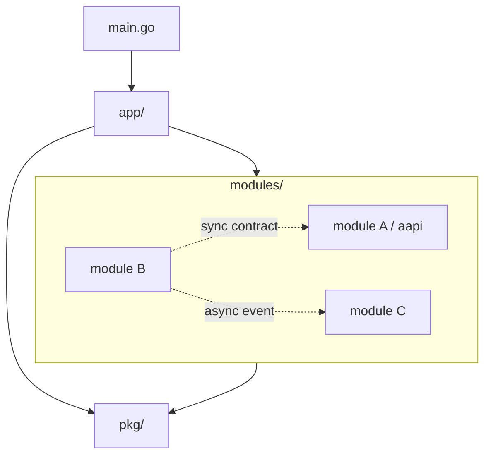

# Architecture

A short guide to how this Go **modular monolith** is structured. Everything here
describes the enduring shape and rules of the codebase — regardless of which
business domains you add or remove.

## Contents

1. [System Shape](#1-system-shape)
2. [Anatomy of a Module](#2-anatomy-of-a-module)
3. [How Modules Talk to Each Other](#3-how-modules-talk-to-each-other)
4. [Sharing Code Between Modules](#4-sharing-code-between-modules)
5. [Enforced Rules](#5-enforced-rules)
6. [Growing From This Template](#6-growing-from-this-template)
7. [Guiding Go Proverbs](#7-guiding-go-proverbs)
8. [Service-Specific Decisions](#service-specific-decisions)

## 1. System Shape



```text
main.go         single binary entry point
app/            composition root: wires pkg and modules together (hand-wired DI)
modules/        business domains, one directory per domain
pkg/            reusable technical building blocks (no business logic)
test/
  arch/         AST import, cycle, and module.json rules (`make arch`)
  e2e/          cross-module end-to-end tests
docs/           OpenAPI spec and architecture diagrams
deploy/         per-environment config files and delivery notes
```

Two layers, one direction:
- **`modules/`** owns business logic. May import `pkg/` and declared `<other>api` contracts.
- **`pkg/`** owns reusable technical primitives (`httpx`, `outbox`, `eventbus`, `config`, `apperr`, `id`, `clock`, `logging`, `telemetry`). Never imports `modules/` or `app/`.
- **`main.go`** and **`app/`** sit above both and are the only production code allowed to import concrete modules.

## 2. Anatomy of a Module

```text
modules/<name>/
  module.json         one-line responsibility + declared dependencies ("uses")
  module.go           wiring: Deps in, pkg/module.Module out (imported only by app/)
  <name>api/          PUBLIC contract: DTOs, interfaces, versioned events (leaf pkg)
  internal/           PRIVATE: Go compiler blocks other modules from importing this
    <entity>.go         domain types & invariants
    service.go          use cases + narrow ports (store, external ACLs, publisher)
    store.go            persistence adapter (in-memory by default; swap for any DB)
    http.go             HTTP routes & handlers (transport structs separate from domain)
    *_test.go           fast black-box unit tests (`package core_test`)
```

Keep files flat inside `internal/` while a module is small. Split sub-packages
inside `internal/` only when a domain grows large — nothing outside the module
changes.

## 3. How Modules Talk to Each Other

Modules never import another module's `internal/` package and never call each
other over localhost HTTP. There are two patterns:

1. **Synchronous query (contract):**
   - The consuming module declares the provider in `"uses"` in `module.json`,
     defines a narrow port inside its own `internal/`, and adapts
     `modules/<provider>/<provider>api` in a small ACL.
   - `app/modules.go` wires `providerModule.API()` into the consumer's `Deps`.
2. **Asynchronous event (outbox):**
   - The publishing module defines a versioned event (`<module>.<fact>.v1`) in
     `<name>api/` and publishes it via `pkg/outbox.Publisher`.
   - `pkg/outbox.Relay` dispatches queued events through `pkg/eventbus` with
     retries and OpenTelemetry trace propagation.
   - Subscribers handle events idempotently keyed on `env.ID`.

## 4. Sharing Code Between Modules

> *"A little copying is better than a little dependency."* — [Rob Pike, Go Proverbs](https://go-proverbs.github.io/)

1. **Domain data or behavior owned by a module** — expose it via `modules/<name>/<name>api/` (e.g. `modules/billing/billingapi/`), declare it in `"uses"` in `module.json`, and wire it in `app/modules.go`. Break two-way dependencies with an async event or a third module above both.
2. **Small type or helper used in 2 modules** — copy it in both modules first so each domain stays free to diverge.
3. **Stable, business-agnostic primitive used across 3+ modules** — promote it to a single-purpose package in `pkg/<name>` (never `utils`, `common`, or `helpers`).

## 5. Enforced Rules

| Rule | Enforced by |
| --- | --- |
| Module internals stay private | Go compiler (`modules/<name>/internal/`) |
| No import cycles | Go compiler |
| `pkg/` never imports `modules/` or `app/` | `test/arch` |
| Modules only see each other via `<name>api` | `test/arch` |
| `module.json` `"uses"` matches code & is acyclic | `test/arch` |
| Contracts (`<name>api`) are leaf packages | `test/arch` |
| No junk-drawer package names (`utils`, `common`, ...) | `test/arch` |
| Every module has a description & `CODEOWNERS` entry | `test/arch` |
| Every `deploy/env/*.env` file is valid | `pkg/config` tests |

## 6. Growing From This Template

- **Adding a database:** keep module ports unchanged. Replace `store.go` per module with a DB adapter and swap `outbox.NewMemoryStore()` in `app/app.go` for a persistent `outbox.Store`. Keep data ownership per module (no cross-module joins).
- **Extracting a module into its own service:** move its store out, replace the in-process `<name>api` facade in `app/modules.go` with an HTTP/gRPC client, and point `outbox.Relay` at a message broker.

## 7. Guiding Go Proverbs

From [Rob Pike](https://github.com/robpike)'s [Go Proverbs](https://go-proverbs.github.io/) ([Gopherfest 2015 talk](https://www.youtube.com/watch?v=PAAkCSZUG1c)) that shape this template:

- **"A little copying is better than a little dependency."** — Duplicate small structs across 2 modules instead of prematurely coupling them.
- **"The bigger the interface, the weaker the abstraction."** — Declare narrow, consumer-owned ports (`Exists`, `GetBySKU`) right next to the code that calls them.
- **"Clear is better than clever."** — Plain constructors in `app/modules.go` and stdlib `net/http` over reflection or DI frameworks.
- **"Errors are values."** / **"Don't just check errors, handle them gracefully."** — Domain errors are typed values (`pkg/apperr`), tested with `errors.Is`, and rendered as RFC 9457 problems.
- **"Design the architecture, name the components, document the details."** — Name packages for the single thing they provide (`httpx`, `outbox`, `clock`), never `utils` or `common`.

---

## Service-Specific Decisions

*Fill this section in as your service evolves after forking the template:*

- **Data store:** *(e.g. PostgreSQL, SQLite, DynamoDB — TBD)*
- **Authentication / Authorization:** *(e.g. JWT middleware in `pkg/httpx` — TBD)*
- **Message broker:** *(in-process `pkg/outbox` + `pkg/eventbus` until external consumers exist)*
- **Deployment target:** *(configure `scripts/deploy.sh` and `deploy/env/`)*
