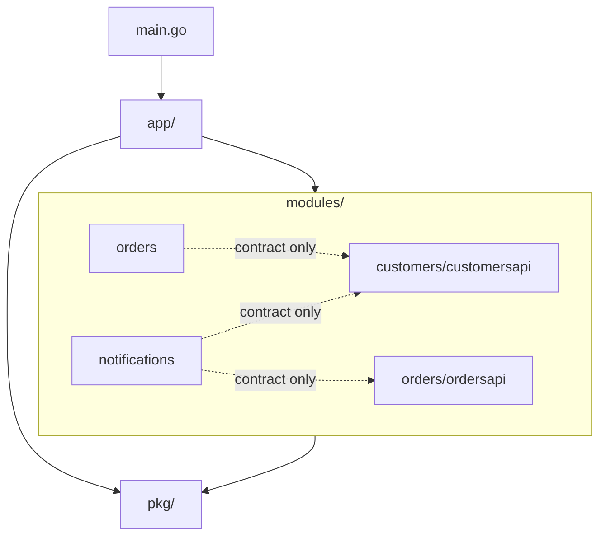

# Architecture

This repository is a template for a **modular monolith** in Go: one Go module,
one binary, one container image, and inside it a set of business modules
(domains) that stay isolated from each other like separate services.

The layout stays flat and Go-idiomatic: `main.go` and `app/` sit at the root,
business domains live under `modules/`, shared reusable packages live under
`pkg/`, and Go's `internal/` compiler rule enforces domain privacy inside each
module (`modules/<name>/internal/`).

Persistence and third-party vendors are out of scope. Example modules ship with
in-memory stores behind repository ports and a storage-agnostic outbox behind
`outbox.Store`, so everything builds, runs and passes end-to-end tests with Go
alone.

## 1. The shape of the system

```text
main.go                     single binary entry point
app/                        composition root: wires pkg and modules together
modules/                    business domains, one directory per domain
  customers/
  orders/
  notifications/
pkg/                        shared reusable packages; knows no business logic
  apperr/                     classified errors (invalid, not found, conflict, ...)
  buildinfo/                  service name and build version
  clock/                      time as a dependency
  config/                     environment -> typed, validated configuration
  event/                      integration event marker
  eventbus/                   in-process event routing with OTel spans
  httpx/                      JSON, OpenAPI docs, RFC 9457 problems, middleware, server
  id/                         UUIDv7 identifiers
  logging/                    slog setup, trace-aware and request-scoped loggers
  module/                     the interface every module implements
  outbox/                     storage-agnostic outbox pattern (Store, Publisher, Relay)
  telemetry/                  OpenTelemetry OTLP setup
test/
  e2e/                      cross-module end-to-end tests (HTTP, outbox, traces)
  arch/                     dependency, cycle, and manifest rules as `go test`
docs/                       OpenAPI spec, ADRs, and architecture diagrams
deploy/                     per-environment config files and delivery notes
```

Two layers with one clear rule:

| Layer | Answers | May depend on |
| --- | --- | --- |
| **modules** | What does the business do? | `pkg/`, and `<other>api` contracts declared in `module.json` |
| **pkg** | What reusable technical primitives do we share? | `pkg/` only (never `modules/` or `app/`) |

`main.go` and `app/` sit above both and are the only production code allowed to
import concrete modules.

## 2. Dependency rules



1. **Dependencies point downwards.** `pkg/` never imports `modules/` or `app/`.
2. **A module's only public surface is its contract package**
   (`modules/<name>/<name>api`). Other modules may import that and nothing
   else from the module.
3. **Inter-module dependencies are declared.** Each module lists the modules it
   uses in `module.json`. Undeclared imports, unused declarations and cycles
   fail `test/arch`.
4. **Contracts are leaves.** A contract imports only `pkg/` (or stdlib), so
   importing one drags in zero module implementation.
5. **Only `app/` wires concrete modules.** `app/modules.go` constructs modules
   and passes contract interfaces explicitly.
6. **No junk drawers.** Packages like `common`, `utils`, `helpers`, or `shared`
   are rejected by `test/arch`.

Go's `internal/` compiler rule enforces rule 2 at compile time: everything under
`modules/<name>/internal/` is unimportable from outside `modules/<name>/`.

## 3. Anatomy of a module

```text
modules/orders/
  module.json               responsibility and declared module dependencies
  module.go                 wiring: Deps in, module.Module out (imported only by app/)
  ordersapi/                PUBLIC contract: DTOs, interfaces, integration events
  internal/                 PRIVATE; enforced by the Go compiler
    order.go                  domain types & business invariants
    money.go                  domain value object (kept local until shared by 3+ modules)
    service.go                use cases + ports (Repository, CustomerDirectory, EventPublisher)
    store.go                  in-memory store (swap for Postgres/SQLite/etc.)
    http.go                   HTTP routes & handlers
    customers.go              ACL adapting customersapi.API to CustomerDirectory
    *_test.go                 fast black-box unit tests (package core_test)
```

Keep files flat inside `internal/` while a module is small or medium. If a
domain grows large, split sub-packages inside `internal/` without changing
anything outside the module.

## 4. How modules talk to each other

### Synchronous: query through a contract

Use when a module needs an answer *now* (e.g. `orders` checks that a customer
exists before accepting an order):

- `modules/orders/module.json` declares `"uses": ["customers"]`.
- `modules/orders/internal/service.go` defines a narrow port (`CustomerDirectory.Exists`).
- `modules/orders/internal/customers.go` adapts `customersapi.API` to that port.
- `app/modules.go` passes `customersModule.API()` into `orders.Deps`.

### Asynchronous: integration events through the outbox

Use when a module announces a fact and does not care who reacts (`orders` emits
`OrderPlaced`; `notifications` reacts):

- `modules/orders/ordersapi` defines `OrderPlaced` (`"orders.order_placed.v1"`).
- `modules/orders/internal/service.go` publishes it via `EventPublisher`.
- `pkg/outbox` appends the envelope + W3C trace headers to `outbox.Store`
  (in-memory by default).
- `pkg/outbox.Relay` polls pending messages with exponential backoff,
  restores trace context and dispatches through `pkg/eventbus`.
- `modules/notifications/internal/adapters.go` handles the event idempotently
  keyed on `env.ID`.

## 5. Working with dependencies between modules

Go's compiler enforces two rules — **no import cycles** and **`internal/` visibility** — and Go's classic proverb guides everything else: *"A little copying is better than a little dependency."*

When two modules appear to need the same thing, follow this order:

1. **Domain data or behavior owned by Module A** (e.g. *"does this customer exist?"*, *"an order was placed"*):
   - Expose a thin interface or versioned event in `modules/a/aapi/`, declare `"uses": ["a"]` in Module B's `module.json`, and wire them in `app/modules.go`. Never move domain behavior into `pkg/`.
   - If both A and B need each other, break the cycle with an async event in one direction, or introduce a third orchestration module above both.
2. **A small domain type or helper used in just 2 modules** (e.g. `Money`, an `Address` struct, or a small validator):
   - **Copy it in both modules first.** Two domains often start with the same struct and quickly diverge (e.g. `orders` needs positive prices while `billing` needs signed refunds). Copying keeps modules decoupled.
3. **A stable, business-agnostic primitive used across 3+ modules** (e.g. `apperr`, `id`, `clock`, `httpx`, `outbox`):
   - Promote it to a single-purpose package in `pkg/<name>` (named after what it does — never `pkg/utils` or `pkg/common`). `test/arch` guarantees `pkg/` never imports `modules/`, keeping dependencies strictly one-way and acyclic.

## 6. Observability, errors & runtime

- **Runtime**: `main.go` -> `app.Main()` runs the HTTP server and outbox relay
  under an `errgroup`, with graceful shutdown on `SIGINT`/`SIGTERM`, `/healthz`,
  `/readyz`, and OpenAPI docs at `/docs` (`/openapi.yaml`).
- **Config**: loaded once from env vars in `pkg/config`. Everything has safe
  defaults; `deploy/env/*.env` files are validated by a unit test.
- **Errors**: `*apperr.Error` carries a `Kind`, stable `Code`, and client-safe
  message. `httpx.Error` renders RFC 9457 `application/problem+json`.
- **Tracing & Logs**: `log/slog` with request/trace IDs + OpenTelemetry OTLP
  export (enabled when `OTEL_EXPORTER_OTLP_ENDPOINT` is set).

## 7. Testing strategy

Every test runs in memory with `go test -race ./...` — no Docker required:

| Level | Proves | Location |
| --- | --- | --- |
| Unit | Domain invariants & use cases with fakes | `modules/*/internal/*_test.go` |
| Shared packages | HTTP helpers, config files, eventbus, outbox retries | `pkg/*/*_test.go` |
| End to end | Full HTTP -> sync ACL -> outbox -> subscriber + traces | `test/e2e/` |
| Architecture | Import rules, manifests, acyclic DAG, owners | `test/arch/` |

## 8. How the rules are enforced

| Rule | Enforced by |
| --- | --- |
| Module internals are private | Go compiler (`modules/<name>/internal/`) |
| No import cycles | Go compiler |
| `pkg/` never imports modules or `app/` | `test/arch` |
| Modules see each other only through `<name>api` | `test/arch` |
| Module dependencies are declared, used and acyclic | `test/arch` + `module.json` |
| Contracts are leaf packages | `test/arch` |
| No `utils` / `common` junk-drawer packages | `test/arch` |
| Every module has an owner and description | `test/arch` + `.github/CODEOWNERS` |
| Every `deploy/env/*.env` file is valid | `pkg/config` tests |
| Idiomatic Go & CVE scan | `golangci-lint` + `govulncheck` |

## 9. Adding a data layer or extracting a service

**Adding a database:** keep module ports unchanged. Replace `store.go` in each
module with a DB-backed implementation (Postgres, SQLite, DynamoDB, etc.) and
swap `outbox.NewMemoryStore()` in `app/app.go` for a DB-backed `outbox.Store`.
Keep data ownership strictly per module — never join across modules.

**Extracting a module into a separate service:**
1. Move its storage out (already behind its repository port).
2. Implement `<other>api.API` with an HTTP/gRPC client instead of the in-process
   facade — consumers stay untouched.
3. Point `outbox.Relay`'s `Dispatcher` at a message broker.
4. Give it its own `main.go` and `app/`.
