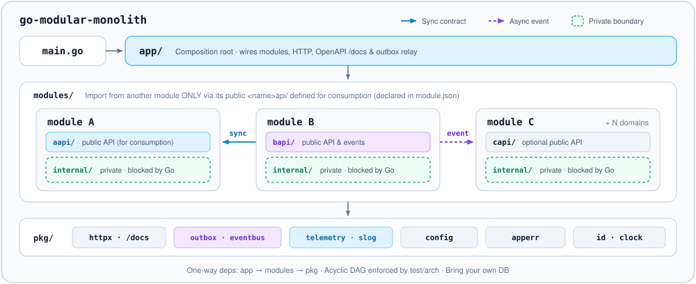

# go-modular-monolith

> **Monolith simplicity, microservice boundaries** — flat, idiomatic Go with compiler-enforced module isolation and zero data-layer lock-in.

[](https://github.com/FeliceGeracitano/go-modular-monolith/actions/workflows/ci.yml)


---

## Architecture

<picture>
  <source media="(prefers-color-scheme: dark)" srcset="docs/assets/architecture-dark.svg">
  <source media="(prefers-color-scheme: light)" srcset="docs/assets/architecture-light.svg">
  
</picture>

```text
main.go         entry point
app/            wires pkg and modules together (hand-wired DI)
modules/        one folder per domain (<name>api/ public contract + internal/ private code)
pkg/            reusable non-domain packages (apperr, clock, config, eventbus, httpx, id, outbox, telemetry)
test/           e2e/ (full-app tests) and arch/ (AST dependency & cycle rules)
```

---

## Highlights

- **Hard module boundaries** — each domain exposes only `<name>api`; private code lives under `modules/<name>/internal/` (enforced by the Go compiler).
- **Executable architecture rules** — `test/arch` checks imports, `module.json` declarations, acyclic dependencies, and `CODEOWNERS` in CI.
- **Sync + async examples included** — `orders` checks `customers` synchronously through `customersapi`, then emits `orders.order_placed.v1` via the storage-agnostic `pkg/outbox` relay to `notifications`.
- **Bring your own data layer** — no database, ORM, or migrations baked in; modules use in-memory stores behind repository ports so `make run` and `make test` need Go only.
- **Stdlib-first & observable** — `net/http` + OpenAPI 3.1 (`/docs`) + RFC 9457 errors, `log/slog`, and OpenTelemetry OTLP traces spanning HTTP → outbox → subscriber.

---

## Quick Start

Requires **Go 1.27+**.

```bash
make run    # HTTP API + outbox relay on :8080 (API docs at http://localhost:8080/docs)
make test   # unit, e2e, and architecture tests (-race)
```

Try the sync + outbox flow across the example modules:

```bash
CUSTOMER_ID=$(curl -sS -X POST http://localhost:8080/api/v1/customers \
  -H 'Content-Type: application/json' \
  -d '{"name":"Ada Lovelace","email":"ada@example.com"}' | jq -r .id)

ORDER_ID=$(curl -sS -X POST http://localhost:8080/api/v1/orders \
  -H 'Content-Type: application/json' \
  -d "{\"customer_id\":\"$CUSTOMER_ID\",\"currency\":\"EUR\",\"lines\":[{\"sku\":\"BOOK-1\",\"quantity\":1,\"unit_price\":2500}]}" | jq -r .id)

curl -sS -X POST http://localhost:8080/api/v1/orders/$ORDER_ID/cancel | jq
curl -sS "http://localhost:8080/api/v1/notifications?customer_id=$CUSTOMER_ID" | jq
```

To start a new service from this template:

```bash
scripts/rename-module.sh github.com/your-org/your-service
make remove-examples
```

Run `make` to see all targets (including `up-observability` for local Grafana traces on `:3000`).

---

## Sharing Between Modules

> *"A little copying is better than a little dependency."* — Go Proverbs

1. **Domain data owned by Module A** → expose a contract in `modules/a/aapi/`, declare `"uses": ["a"]` in `module.json`, wire in `app/modules.go`. Break two-way needs with an async event.
2. **Small type/helper in 2 modules** → copy it first so each domain stays free to evolve.
3. **Stable, business-agnostic primitive in 3+ modules** → promote to a single-purpose `pkg/<name>` (never `utils` or `common`).

---

## Docs

- [ARCHITECTURE.md](ARCHITECTURE.md) — rules, patterns, and how to add a database or extract a service
- [docs/openapi.yaml](docs/openapi.yaml) — OpenAPI 3.1 spec (interactive UI served at `GET /docs`)
- [docs/adr/](docs/adr/README.md) — architecture decision records
- [deploy/README.md](deploy/README.md) — environments and CI/CD pipeline
- [.env.example](.env.example) — runtime configuration defaults
