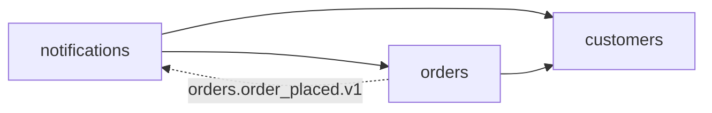

# Module map

<!-- Generated from the code by `make docs`. Do not edit by hand. -->

A solid arrow means "calls, through its contract". A dotted arrow is an
integration event, from publisher to subscriber.

| Module | Responsibility | Owners | Depends on |
| --- | --- | --- | --- |
| [customers](#customers) | Registers customers and answers questions about them. | @FeliceGeracitano | none |
| [notifications](#notifications) | Tells customers about things that happened elsewhere, such as a placed order. | @FeliceGeracitano | `customers`, `orders` |
| [orders](#orders) | Places orders for existing customers and announces them. | @FeliceGeracitano | `customers` |

## customers

Registers customers and answers questions about them.

- **Code:** [`internal/modules/customers`](../internal/modules/customers)
- **Database schema:** `customers`
- **Depends on:** none
- **Publishes:** none
- **Subscribes to:** none
- **HTTP:**
  - `GET /api/v1/customers/{id}`
  - `POST /api/v1/customers`

## notifications

Tells customers about things that happened elsewhere, such as a placed order.

- **Code:** [`internal/modules/notifications`](../internal/modules/notifications)
- **Database schema:** `notifications`
- **Depends on:** `customers`, `orders`
- **Publishes:** none
- **Subscribes to:** `orders.order_placed.v1`
- **HTTP:** none

## orders

Places orders for existing customers and announces them.

- **Code:** [`internal/modules/orders`](../internal/modules/orders)
- **Database schema:** `orders`
- **Depends on:** `customers`
- **Publishes:** `orders.order_placed.v1`
- **Subscribes to:** none
- **HTTP:**
  - `GET /api/v1/orders/{id}`
  - `POST /api/v1/orders`
